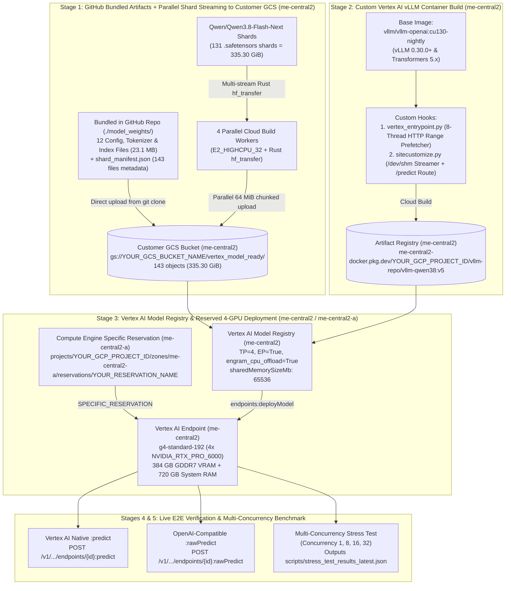
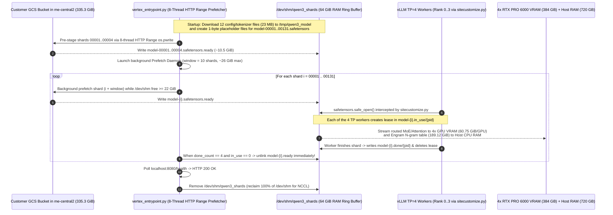

# Deploying `Qwen/Qwen3.8-Flash-Next` (335.3 GiB MoE) on a Reserved 4-GPU G4 Node (`g4-standard-192`) in `me-central2` (`me-central2-a`)

Production-ready, **one-command** automation repository for deploying **`Qwen/Qwen3.8-Flash-Next`** (`335.30 GiB` across `131` `.safetensors` shards + `12` bundled configuration/tokenizer/index files) on **Google Cloud Vertex AI Prediction** in **`me-central2`** using a **reserved 4-GPU G4 node (`g4-standard-192` with `4 × NVIDIA_RTX_PRO_6000`, 384 GB GDDR7 VRAM, 720 GB System RAM)** in **`me-central2-a`**.

---

## 1. One-Command Customer Quickstart

### Prerequisites
1. **Google Cloud SDK (`gcloud`)** authenticated with a principal that has permissions for Vertex AI, Cloud Storage, Artifact Registry, Compute Engine Reservations, and Cloud Build:
   ```bash
   gcloud auth login
   gcloud auth application-default login
   ```
2. **A Reserved `g4-standard-192` (4 × `NVIDIA_RTX_PRO_6000`) Node** in **`me-central2-a`**.
   - To check your reservation name in `me-central2-a`:
     ```bash
     gcloud compute reservations list --project=YOUR_GCP_PROJECT_ID --filter="zone ~ me-central2-a"
     ```

### Option A: Single CLI Command (No File Edits Required)

Clone this repository and run [`./deploy.sh`](deploy.sh) with your **Project ID**, **GCS Bucket Name** (created automatically in `me-central2` if it does not exist), and **Reservation Name** in `me-central2-a`:

```bash
git clone https://github.com/straifi/qwen3-8-flash-next-vertex-4gpu.git
cd qwen3-8-flash-next-vertex-4gpu

./deploy.sh \
  --project-id YOUR_GCP_PROJECT_ID \
  --bucket-name YOUR_GCS_BUCKET_NAME \
  --reservation-name YOUR_RESERVATION_NAME
```

> [!TIP]
> **Automatic Reservation Discovery in `me-central2-a`**:
> If you only have a single active G4 reservation in `me-central2-a`, you can pass `--reservation-name AUTO_DISCOVER` and the script will automatically query `gcloud compute reservations list` in `me-central2-a` and bind to your reservation!

### Option B: Edit `deployment_config.json` + Run `./deploy.sh`

1. Open [`deployment_config.json`](deployment_config.json) and replace the 3 customer placeholders:

| Config Key | Placeholder | Description |
| :--- | :--- | :--- |
| `gcp.project_id` | `"YOUR_GCP_PROJECT_ID"` | Your Google Cloud Project ID where Vertex AI and GCS will run |
| `gcp.bucket_name` | `"YOUR_GCS_BUCKET_NAME"` | Target GCS bucket in `me-central2` (auto-created if it does not exist) |
| `compute.reservation.name` | `"YOUR_RESERVATION_NAME"` | Name of your Compute Engine G4 reservation in `me-central2-a` (or `"AUTO_DISCOVER"`) |
| `compute.reservation.project_id` | `"YOUR_GCP_PROJECT_ID"` | Project ID that owns the reservation (set to host project ID if using a Shared Reservation) |

2. Run the unified deployment & benchmark command:
```bash
./deploy.sh
```

---

## 2. End-to-End 5-Stage Pipeline Architecture

When you run `./deploy.sh` (which executes [`deploy_end_to_end.py`](deploy_end_to_end.py)), it runs all 5 stages automatically:



### Inside Stage 3: 8-Thread HTTP Range Sliding-Window `/dev/shm` RAM Weight Streaming

Vertex AI Prediction imposes container overlay disk limits (`100 GiB`) and `gcsfuse` latency when 4 Tensor-Parallel worker processes simultaneously `mmap` 335.3 GiB of `.safetensors` shards. Our custom container solves this via a **10-shard sliding-window RAM ring buffer in `/dev/shm/qwen3_shards`** (`~26 GiB` peak footprint inside the `64 GiB` `/dev/shm`):



---

## 3. How `Qwen/Qwen3.8-Flash-Next` (335.3 GiB) Fits on a 4-GPU `g4-standard-192` Node

A `g4-standard-192` node provides **4 × `NVIDIA_RTX_PRO_6000` Blackwell Server Edition GPUs** (`96 GB` GDDR7 per GPU = `384 GB` total VRAM), **192 vCPUs**, and **720 GB of System RAM**.

By enabling **`--engram-config={"cpu_offload":true}`** alongside **`--tensor-parallel-size=4`** and **`--enable-expert-parallel`**, vLLM offloads the sparse **189.12 GiB Engram N-gram embedding table** to the 720 GB host RAM while sharding all active MoE experts, shared experts, Gated DeltaNet states, and full-attention layers across the 4 GPUs:

| Physical Resource on `g4-standard-192` | Worker Process Role | Model Weights + Runtime | Peak Activation + CUDA Graph | FP8 KV Cache Reserved (`0.90` util) | Total Memory Used | Total Hardware Capacity |
| :--- | :--- | :---: | :---: | :---: | :---: | :---: |
| **GPU 0 (`NVIDIA_RTX_PRO_6000`)** | `Worker_TP0_EP0` | `62.03 GiB` (`60.75 GiB` weights) | `4.68 GiB` (`3.29 + 1.39`) | **`20.16 GiB`** | **`86.87 GiB`** | `94.97 GiB` (`96 GB`) |
| **GPU 1 (`NVIDIA_RTX_PRO_6000`)** | `Worker_TP1_EP1` | `62.03 GiB` (`60.75 GiB` weights) | `4.68 GiB` (`3.29 + 1.39`) | **`20.16 GiB`** | **`86.87 GiB`** | `94.97 GiB` (`96 GB`) |
| **GPU 2 (`NVIDIA_RTX_PRO_6000`)** | `Worker_TP2_EP2` | `62.03 GiB` (`60.75 GiB` weights) | `4.68 GiB` (`3.29 + 1.39`) | **`20.16 GiB`** | **`86.87 GiB`** | `94.97 GiB` (`96 GB`) |
| **GPU 3 (`NVIDIA_RTX_PRO_6000`)** | `Worker_TP3_EP3` | `62.03 GiB` (`60.75 GiB` weights) | `4.68 GiB` (`3.29 + 1.39`) | **`20.16 GiB`** | **`86.87 GiB`** | `94.97 GiB` (`96 GB`) |
| **Host System RAM (`192 vCPUs`)** | CPU-Offloaded Engram Table + `/dev/shm` | **`189.12 GiB`** (Engram N-gram embeddings) | `~26 GiB` (`/dev/shm` during load, `0 GiB` after `/health`) | — | **`~205 GiB`** | **`720 GB`** |

- **Total GPU KV Cache across 4 GPUs**: **`80.64 GiB`** (`20.16 GiB × 4`) = **`1,269,296` tokens** (`38.74x` maximum concurrency at `32,768` context length).
- **Cold-Start Model Load Time**: **`~414 seconds` (`6.9 minutes`)** across all 131 shards via the 8-thread HTTP Range `/dev/shm` streamer.

---

## 4. Specific Reservation Configuration (`me-central2-a`)

When [`deploy_end_to_end.py`](deploy_end_to_end.py) calls `endpoints:deployModel` in `me-central2`, it injects the exact `reservationAffinity` block into `deployedModel.dedicatedResources.machineSpec` required by Vertex AI to consume your reserved `g4-standard-192` node in `me-central2-a`:

```json
{
  "deployedModel": {
    "model": "projects/YOUR_GCP_PROJECT_ID/locations/me-central2/models/MODEL_ID",
    "displayName": "qwen3-8-flash-next-vllm-4gpu-g4-standard-192",
    "dedicatedResources": {
      "machineSpec": {
        "machineType": "g4-standard-192",
        "acceleratorType": "NVIDIA_RTX_PRO_6000",
        "acceleratorCount": 4,
        "reservationAffinity": {
          "reservationAffinityType": "SPECIFIC_RESERVATION",
          "key": "compute.googleapis.com/reservation-name",
          "values": [
            "projects/YOUR_GCP_PROJECT_ID/zones/me-central2-a/reservations/YOUR_RESERVATION_NAME"
          ]
        }
      },
      "minReplicaCount": 1,
      "maxReplicaCount": 1
    },
    "disableContainerLogging": false
  },
  "trafficSplit": {
    "0": 100
  }
}
```

> [!NOTE]
> **Shared Reservations & Automatic Reservations**:
> - If your reservation in `me-central2-a` is a **Shared Reservation** owned by a different host project, set `"project_id": "YOUR_HOST_PROJECT_ID"` inside `compute.reservation` in [`deployment_config.json`](deployment_config.json) (or pass `--reservation-project-id YOUR_HOST_PROJECT_ID`).
> - If your reservation in `me-central2-a` is configured for automatic consumption (`ANY_RESERVATION`), pass `--reservation-affinity-type ANY_RESERVATION`.

---

## 5. Repository Structure

| File / Directory | Stage | Purpose |
| :--- | :--- | :--- |
| **[`deploy.sh`](deploy.sh)** | **All (1–5)** | **One-command customer entrypoint**: verifies `gcloud` & Python dependencies and executes `deploy_end_to_end.py`. |
| **[`deployment_config.json`](deployment_config.json)** | **Config** | **Central configuration file** pre-configured for `me-central2`, `g4-standard-192` (`4 × NVIDIA_RTX_PRO_6000`), and `SPECIFIC_RESERVATION` in `me-central2-a`. |
| **[`deploy_end_to_end.py`](deploy_end_to_end.py)** | **All (1–5)** | **Unified 5-stage Python orchestrator** supporting config-driven and CLI flag execution. |
| **[`model_weights/`](model_weights/)** | **Stage 1** | **Pre-packaged model artifacts in GitHub**: all 12 config, tokenizer, vocabulary, and shard-index files (`config.json`, `tokenizer.json`, `model.safetensors.index.json`, etc.) + [`shard_manifest.json`](model_weights/shard_manifest.json) (exact metadata & hashes for all 143 files / 335.30 GiB) + [`stage_weights_to_gcs.py`](model_weights/stage_weights_to_gcs.py). |
| [`hf_transfer_job/transfer_shards.py`](hf_transfer_job/transfer_shards.py) | Stage 1 | Uploads bundled `model_weights/` files and streams the 131 `.safetensors` shards in bounded batches using Rust `hf_transfer`. |
| [`hf_transfer_job/cloudbuild.yaml`](hf_transfer_job/cloudbuild.yaml) | Stage 1 | Cloud Build worker specification (`E2_HIGHCPU_32`) for parallel shard streaming to `me-central2`. |
| [`hf_transfer_job/run_hf_to_gcs_transfer.sh`](hf_transfer_job/run_hf_to_gcs_transfer.sh) | Stage 1 | Standalone shell script to create the `me-central2` GCS bucket, upload `model_weights/`, and run 4 parallel Cloud Build workers. |
| [`vllm_container/Dockerfile`](vllm_container/Dockerfile) | Stage 2 | Builds the custom Vertex AI vLLM image (`vllm/vllm-openai:cu130-nightly`) with `sitecustomize.py` and `vertex_entrypoint.py`. |
| [`vllm_container/vertex_entrypoint.py`](vllm_container/vertex_entrypoint.py) | Stage 2 & 3 | Container entrypoint with **8-thread parallel HTTP Range downloader (`os.pwrite`)** and `/dev/shm` sliding-window shard prefetcher daemon. |
| [`vllm_container/sitecustomize.py`](vllm_container/sitecustomize.py) | Stage 2, 3, 4 | Intercepts `safetensors.safe_open` across all 4 TP worker processes and injects a dual-mode FastAPI `POST /predict` route supporting `:predict` and `:rawPredict`. |
| [`scripts/deploy_me_central2_reserved.py`](scripts/deploy_me_central2_reserved.py) | Stage 3 | Standalone deployer for `me-central2` when Stage 1 & 2 are already complete. |
| [`scripts/resume_monitor_and_test.py`](scripts/resume_monitor_and_test.py) | Stage 3 & 4 | Resumable LRO deployment monitor that streams container logs and triggers E2E + stress tests upon completion. |
| [`scripts/stress_test_endpoint.py`](scripts/stress_test_endpoint.py) | Stage 4 & 5 | Standalone E2E functional verifier and multi-concurrency stress benchmark suite (`Concurrency = 1, 8, 16, 32`). |
| [`scripts/stress_test_results.json`](scripts/stress_test_results.json) | Stage 5 | Reference E2E & multi-concurrency benchmark results JSON. |
| [`BENCHMARK_REPORT.md`](BENCHMARK_REPORT.md) | Report | Detailed 4-GPU (`g4-standard-192`) hardware telemetry, memory breakdown, and latency/throughput benchmark tables. |

---

## 6. Testing & Benchmarking the Deployed Endpoint in `me-central2`

While `./deploy.sh` runs both functional verification (Stage 4) and the multi-concurrency benchmark (Stage 5) automatically at the end of deployment, you can also run tests manually at any time.

### 6.1 Test via Vertex AI `:predict` (`curl`)
```bash
PROJECT_ID="YOUR_GCP_PROJECT_ID"
REGION="me-central2"
ENDPOINT_ID="YOUR_ENDPOINT_ID"
TOKEN="$(gcloud auth print-access-token)"

curl -s -X POST \
  -H "Authorization: Bearer ${TOKEN}" \
  -H "Content-Type: application/json" \
  "https://${REGION}-aiplatform.googleapis.com/v1/projects/${PROJECT_ID}/locations/${REGION}/endpoints/${ENDPOINT_ID}:predict" \
  -d '{
    "instances": [
      {
        "messages": [
          {"role": "system", "content": "You are a concise AI assistant."},
          {"role": "user", "content": "State your model name and summarize how Gated DeltaNet + MoE with CPU-offloaded Engram works on 4 RTX PRO 6000 GPUs in 2 sentences."}
        ],
        "max_tokens": 512,
        "temperature": 0.2,
        "chat_template_kwargs": {"enable_thinking": false}
      }
    ]
  }' | jq .
```

### 6.2 Test via OpenAI-Compatible `:rawPredict` (`curl`)
```bash
PROJECT_ID="YOUR_GCP_PROJECT_ID"
REGION="me-central2"
ENDPOINT_ID="YOUR_ENDPOINT_ID"
TOKEN="$(gcloud auth print-access-token)"

curl -s -X POST \
  -H "Authorization: Bearer ${TOKEN}" \
  -H "Content-Type: application/json" \
  "https://${REGION}-aiplatform.googleapis.com/v1/projects/${PROJECT_ID}/locations/${REGION}/endpoints/${ENDPOINT_ID}:rawPredict" \
  -d '{
    "model": "Qwen/Qwen3.8-Flash-Next",
    "messages": [
      {"role": "user", "content": "Write a Python function for Kahn topological sort with type annotations."}
    ],
    "max_tokens": 512,
    "temperature": 0.1,
    "chat_template_kwargs": {"enable_thinking": false}
  }' | jq .
```

### 6.3 Run the Full E2E & Multi-Concurrency Performance Benchmark Suite
```bash
python3 scripts/stress_test_endpoint.py YOUR_ENDPOINT_ID me-central2
```
